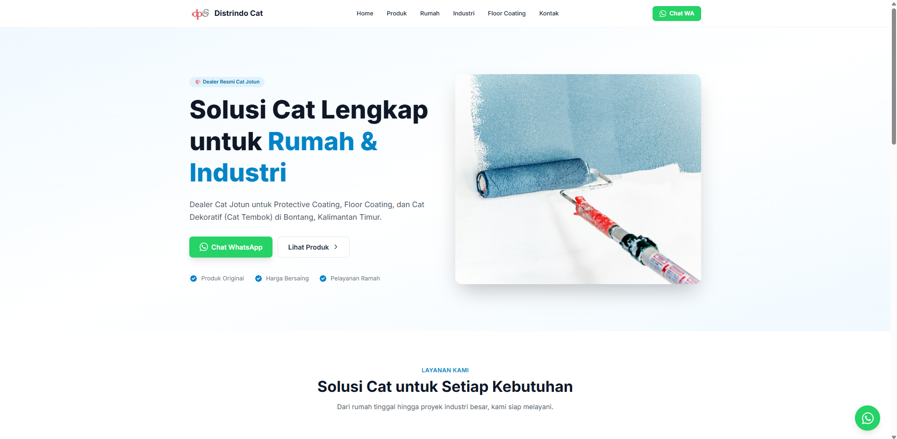
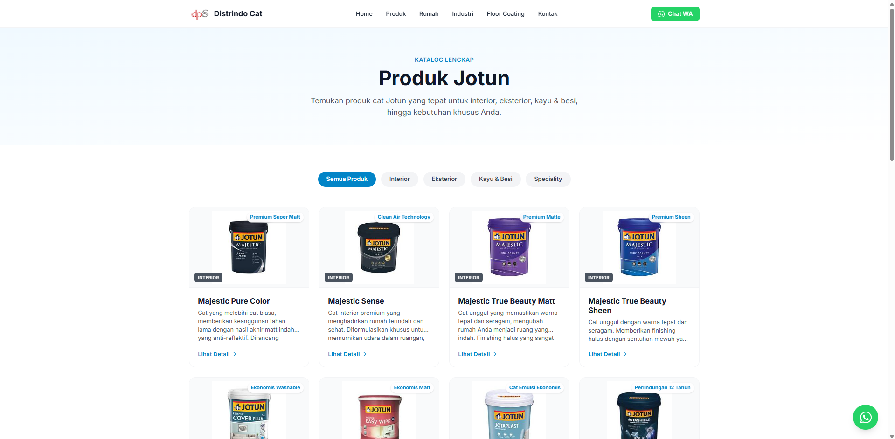
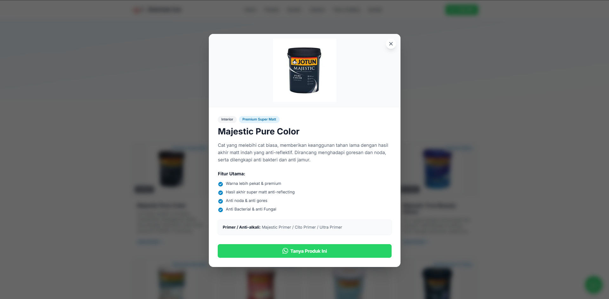
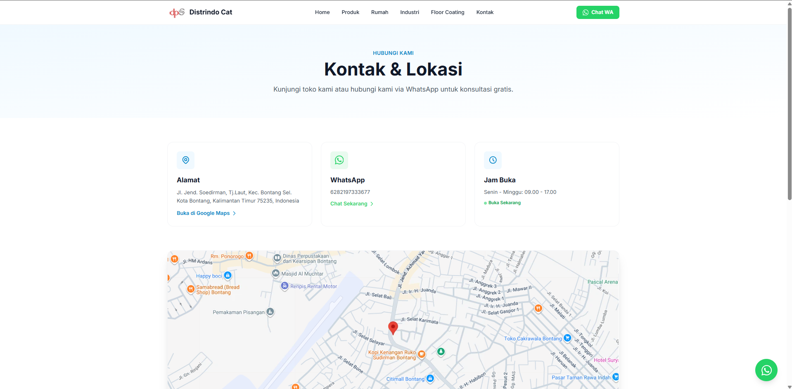

# 🎨 Website Company Profile PT. Distrindo Pratama Sejahtera

Website *company profile* interaktif yang dibangun untuk menampilkan katalog produk cat **Jotun**, layanan, dan informasi kontak. Project ini dikembangkan dari nol sebagai portofolio *Full-Stack Web Development*.

## 🚀 Teknologi yang Digunakan
- **Backend**: Laravel 12 (PHP 8.2)
- **Frontend**: Tailwind CSS v4 & Vite
- **Interaksi**: Alpine.js (untuk filter produk & modal dinamis)
- **Database**: MySQL

## ✨ Fitur Utama
1. **Katalog Produk Dinamis**: Menampilkan 19+ produk Jotun berdasarkan kategori (Interior, Eksterior, Kayu & Besi, Speciality) dengan fitur filter tanpa *reload* halaman.
2. **Modal Detail Produk**: Menampilkan penjelasan, fitur utama, dan rekomendasi primer secara interaktif.
3. **Integrasi WhatsApp**: Tombol pesan langsung ke WA admin dengan pesan otomatis (*pre-filled message*).
4. **Peta Lokasi**: Integrasi Google Maps (*embed*) di halaman kontak.
5. **Desain Responsif**: Nyaman dilihat di HP, tablet, maupun desktop.
6. **Animasi UI**: Efek *scroll reveal* dan *page transition* yang halus.

## 📸 Tampilan Website

**Halaman Utama (Home)**


**Katalog Produk**


**Detail Produk (Modal Interaktif)**


**Kontak & Lokasi (Integrasi Maps)**


## 🛠️ Cara Menjalankan Secara Lokal
Jika Anda ingin menjalankan project ini di komputer Anda:

1. Clone repository ini:
   ```bash
   git clone https://github.com/lReisyaa/distrindo-cat-web.git
